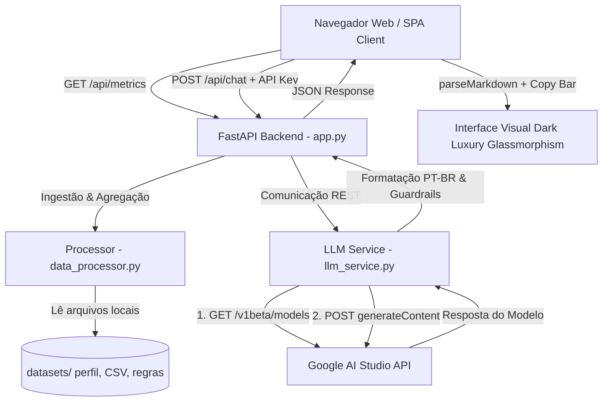

<a name="topo"></a>
<h1 align="center">💎 FinScan — Analista de Perfil Financeiro</h1>

<p align="center">
  
  
  
  
  
</p>

> **Assistente Virtual de Inteligência Artificial para Diagnóstico Financeiro Pessoal, Orçamento 50-30-20 e Cálculo de Reserva de Emergência**

O **FinScan** é uma aplicação web full-stack desenvolvida em **Python (FastAPI)** e **Web Pure Vanilla (HTML5/CSS3/JS)**, criada com a missão de atuar como um **Analista Educacional de Perfil Financeiro Pessoal**. 

Baseado na metodologia orçamentária **50-30-20**, o FinScan analisa extratos de movimentações em tempo real, avalia a cobertura da reserva de emergência e interage via chat generativo multimodal alimentado pelo **Google Gemini (Gemini 2.0 / 1.5 Flash)** em uma elegante interface *Dark Luxury Glassmorphic*.

---

## 📸 Demonstração da Aplicação em Vídeo

<p align="center">
  <video src="docs/figures/FinScan-IA.mp4" controls style="max-height: 400px; width: auto; max-width: 100%; object-fit: contain; border-radius: 8px;">
    Seu navegador não suporta a exibição de vídeos HTML5.
  </video><br/>
  <sub><i><b>Interface:</b> Apresentação completa e demonstração interativa do FinScan (IA Generativa, Dashboard 50-30-20, e Guardrails CVM).</i></sub>
</p>

---

## 🌟 Principais Recursos & Soluções de Engenharia

O **FinScan** foi projetado para oferecer alta confiabilidade, ausência de bibliotecas pesadas no frontend e máxima resiliência na comunicação com os serviços de Inteligência Artificial:

### 1. Descoberta Dinâmica de Modelos Gemini (Python REST) 🔍
Para evitar erros HTTP `404 Not Found` decorrentes de descontinuação de nomes fixos de modelos (ex: `gemini-pro`), o módulo de integração realiza previamente um `GET` assíncrono à rota `/v1beta/models?key=KEY`. A aplicação lista em tempo real os modelos habilitados para a chave informada, priorizando versões de alta velocidade (`gemini-2.0-flash`, `gemini-1.5-flash-latest`).

```python
# Trecho da descoberta dinâmica de modelos no backend (llm_service.py)
dynamic_models = []
models_url = f"https://generativelanguage.googleapis.com/v1beta/models?key={api_key}"
with urllib.request.urlopen(models_url, timeout=12) as m_resp:
    if m_resp.status == 200:
        m_body = json.loads(m_resp.read().decode("utf-8"))
        for m in m_body.get("models", []):
            m_name = m.get("name", "").replace("models/", "")
            methods = m.get("supportedGenerationMethods", [])
            if "generateContent" in methods:
                dynamic_models.append(m_name)
```

### 2. Formatador Numérico Rígido no Padrão PT-BR 📊
Toda a pipeline de dados garante que valores monetários e percentuais sejam estritamente formatados sob o padrão brasileiro (ponto para milhar e vírgula para decimal, ex: `R$ 5.000,00`, `83,0%`, `3,0 meses`), eliminando inconsistências visuais comuns em modelos LLM padrão.

### 3. Interpretador Nativo de Markdown & Copy Bar Externa 📝
O frontend processa marcadores Markdown (títulos `###`, subcabeçalhos `####`, listas com marcadores `•` ou numéricas `1.`) utilizando um interpretador próprio escrito em **Vanilla JS**, sem qualquer dependência externa. Cada balão de resposta é acompanhado por uma barra externa de ações com botão **Copiar** (padrão de interfaces como Claude, ChatGPT e Gemini).

```javascript
/* Trecho do parser nativo de Markdown no frontend (script.js) */
function parseMarkdown(text) {
  let html = text
    .replace(/^### (.*$)/gim, '<h3 class="md-h3">$1</h3>')
    .replace(/^#### (.*$)/gim, '<h4 class="md-h4">$1</h4>')
    .replace(/^\bullet (.*$)/gim, '<li class="md-li">$1</li>')
    .replace(/^\* (.*$)/gim, '<li class="md-li">$1</li>');
  return html;
}
```

### 4. Sincronização Live Sem Recarregamento 🔄
O painel de indicadores conta com o botão **[Atualizar]**, que aciona assincronamente a rota `/api/metrics`. O backend rele os arquivos `perfil_cliente.json` e `transacoes.csv`, recalcula as somatórias com Pandas e atualiza o estado visual instantaneamente na tela.

---

## 💡 Guia Rápido: Como obter a API Key Gratuita do Gemini

O **Google Gemini** oferece uma cota gratuita generosa no plano padrão via **Google AI Studio**, sem necessidade de cadastrar cartão de crédito:

1. Acesse o portal [Google AI Studio](https://aistudio.google.com/).
2. Faça login com sua conta do Google / Gmail.
3. Clique em **"Get API Key"** (ou **"Create API Key"**).
4. Copie a chave gerada (iniciada por `AQ.Ab8RN...`).
5. Na interface do **FinScan**, cole a chave no campo do cabeçalho superior (ou salve no arquivo `.env` do backend).

*(Nota: Sem a chave informada, o FinScan opera no **Modo Didático Pré-definido**, permitindo explorar o Dashboard e testar os botões de perguntas rápidas).*

---

## 📐 Arquitetura do Sistema

A aplicação segue o padrão de **arquitetura desacoplada**, onde a interface SPA consome endpoints REST purificados via FastAPI em Python:



---

## 📊 Indicadores da Regra 50-30-20 no FinScan

Com base nas movimentações do cliente de exemplo (`perfil_cliente.json` e `transacoes.csv`), a aplicação consolida a seguinte distribuição orçamentária:

| Categoria Orçamentária | Composição dos Gastos | Meta Ideal (50-30-20) | Valor Atual (R$) | Percentual Atual | Status do Diagnóstico |
| :--- | :--- | :---: | :---: | :---: | :---: |
| **Necessidades Essenciais** | Aluguel, Supermercado, Saúde, Transporte | **50,0%** | **R$ 4.150,00** | **83,0%** | ⚠️ Acima da Meta |
| **Desejos & Estilo de Vida** | Lazer, Restaurantes, Assinaturas | **30,0%** | **R$ 750,00** | **15,0%** | ✅ Dentro da Meta |
| **Economias & Aportes** | Reserva, Investimentos, Tesouro Selic | **20,0%** | **R$ 1.600,00** | **32,0%** | 💡 Acima da Meta |

* **Renda Mensal Consolidada:** R$ 5.000,00
* **Reserva de Emergência Atual:** R$ 12.500,00
* **Cobertura da Reserva:** **3,0 meses** de despesas essenciais (Meta recomendada: 6,0 meses).

---

## 🛡️ Guardrails e Compliance CVM

Para manter a conformidade com as diretrizes regulatórias do mercado financeiro brasileiro (CVM/ANBIMA), o FinScan adota restrições estritas de segurança em seu System Prompt:

- **Recusa Didática de Ativos Específicos:** O assistente não indica compra, venda ou alocação em ativos específicos (ações como `PETR4` ou `VALE3`, fundos imobiliários, criptomoedas ou produtos de bancos específicos).
- **Filtro de Escopo Temático:** Perguntas desalinhadas de finanças pessoais (culinária, esportes, entretenimento) são recusadas polidamente, reafirmando o escopo orçamentário.
- **Card Visual de Safety Disclaimer:** Respostas que abordem limitações institucionais incluem a assinatura `*Nota de segurança:*`, que dispara a renderização de um card visual destacado com ícone 🛡️ e borda metálica *Antique Brass*.

---

## 📂 Estrutura de Diretórios

```text
finscan-ia/
├── README.md                      # Documentação principal e guia do repositório (esta página)
├── .env.example                   # Modelo de configuração de variável de ambiente (GEMINI_API_KEY)
├── .gitignore                     # Regras de exclusão do controle de versão Git
├── requirements.txt               # Lista de dependências Python (FastAPI, Uvicorn, Pandas, Pydantic)
├── datasets/                      # Datasets locais estruturados
│   ├── perfil_cliente.json        # Cadastro do cliente (Nome, Renda, Reserva, Objetivos)
│   ├── transacoes.csv             # Extrato de receitas, despesas e aportes financeiros
│   └── regras_indicadores.json    # Parâmetros e agrupamentos da Regra 50-30-20
├── docs/                          # Suíte de documentação técnica e científica
│   ├── README.md                  # Central de navegação pela documentação
│   ├── 01-escopo-e-persona.md     # Definição de persona, tom de voz e diretrizes CVM
│   ├── 02-base-de-dados.md        # Esquema detalhado das tabelas e arquivos JSON/CSV
│   ├── 03-engenharia-de-prompts.md# System Prompt, RAG e descoberta dinâmica de modelos
│   ├── 04-arquitetura-aplicacao.md# Diagramas de fluxo, rotas REST e desacoplamento SPA
│   ├── 05-avaliacao-e-metricas.md # Matriz de validação qualitativa e casos de teste
│   └── figures/                   # Recursos de mídia e demonstração da aplicação
│       └── FinScan-IA.mp4         # Vídeo de demonstração e visão geral do assistente
├── src/
│   ├── backend/                   # Servidor API RESTful em Python (FastAPI)
│   │   ├── app.py                 # Rotas FastAPI e montagem da aplicação estática
│   │   ├── data_processor.py      # Agregação de dados via Pandas e cálculo 50-30-20
│   │   └── llm_service.py         # Integração REST com Google Gemini e Guardrails
│   └── frontend/                  # Interface Web SPA em Pure Vanilla Web Standards
│       ├── index.html             # Estrutura HTML5 semântica e acessível
│       ├── style.css              # Design System Dark Luxury & Glassmorphism
│       └── script.js              # Controle de estado, API Key, Markdown parser e copy bar
└── tests/
    └── eval_cases.json            # Suíte de testes de validação dos Guardrails
```

---

## 🚀 Passo a Passo de Instalação e Execução Local

### Pré-requisitos
- **Python 3.10 ou superior** instalado ([python.org](https://www.python.org/)).
- Navegador web moderno (Chrome, Edge, Firefox, Safari).

---

### Step 1: Clonar o Repositório
```bash
git clone https://github.com/douglascmoura/finscan-ia.git
cd finscan-ia
```

---

### Step 2: Criar e Ativar o Ambiente Virtual (`venv`)

**No Windows (PowerShell):**
```powershell
python -m venv venv
.\venv\Scripts\Activate.ps1
```

**No Linux ou macOS:**
```bash
python3 -m venv venv
source venv/bin/activate
```

---

### Step 3: Instalar as Dependências do Backend
```bash
pip install -r requirements.txt
```

---

### Step 4: Configurar a Chave da API do Gemini (Opcional)
Se desejar que o servidor já inicie com a chave configurada:
1. Copie o arquivo `.env.example` criando um arquivo chamado `.env`.
2. Insira sua chave no arquivo:

```env
GEMINI_API_KEY=sua_chave_gemini_aqui
```

*(Nota: O usuário também pode colar a chave diretamente pela interface web da aplicação).*

---

### Step 5: Iniciar o Servidor FastAPI
Execute a aplicação a partir da raiz do projeto:

```bash
python src/backend/app.py
```

---

### Step 6: Acessar a Aplicação Web
Abra o navegador e acesse:

👉 **[http://127.0.0.1:8000/](http://127.0.0.1:8000/)** ou **[http://localhost:8000/](http://localhost:8000/)**

---

## 📡 Documentação das Rotas da API

Com o servidor em execução, a documentação interativa OpenAPI estará disponível automaticamente em:
👉 **[http://127.0.0.1:8000/docs](http://127.0.0.1:8000/docs)**

### Endpoints Principais:

#### 1. `GET /api/metrics`
- **Descrição:** Lê os arquivos de dados (`perfil_cliente.json` e `transacoes.csv`), processa a soma das categorias via Pandas e retorna os percentuais da Regra 50-30-20 e cobertura de reserva de emergência em JSON.

#### 2. `POST /api/chat`
- **Descrição:** Recebe um JSON `{ "message": "...", "api_key": "..." }`, executa a busca dinâmica de modelos do Gemini e retorna o diagnóstico formatado em Markdown com o resumo das métricas.

---

## 📚 Central de Documentação Técnica (`docs/`)

Para aprofundar-se na arquitetura e engenharia do projeto, consulte os cadernos explicativos disponíveis na pasta [`docs/`](./docs/):

| Documento | Título & Conteúdo | Link Direto |
| :--- | :--- | :--- |
| **Documento 01** | Escopo, Persona e Guardrails de Compliance CVM | [`01-escopo-e-persona.md`](./docs/01-escopo-e-persona.md) |
| **Documento 02** | Esquema dos Datasets Locais e Regra 50-30-20 | [`02-base-de-dados.md`](./docs/02-base-de-dados.md) |
| **Documento 03** | Engenharia de Prompts, System Prompt e REST Gemini | [`03-engenharia-de-prompts.md`](./docs/03-engenharia-de-prompts.md) |
| **Documento 04** | Arquitetura do Sistema e Fluxo de Mensagens | [`04-arquitetura-aplicacao.md`](./docs/04-arquitetura-aplicacao.md) |
| **Documento 05** | Avaliação Qualitativa, Matriz de Validação e Testes | [`05-avaliacao-e-metricas.md`](./docs/05-avaliacao-e-metricas.md) |

---

## ✍🏽 Autor

<table align="center">
  <tr>
    <td align="center" width="150px">
      <br />
      <sub><b>Douglas Chaves Moura</b></sub>
    </td>
    <td>
      <p>Estatístico, pesquisador e cientista de dados idealizador do ecossistema <b>DOCHMO</b>. Atua no desenvolvimento de soluções quantitativas avançadas, inteligência artificial generativa/multimodal e estatística computacional de alta performance.</p>
      <p align="left">
        <a href="https://github.com/douglascmoura"></a>
        <a href="https://www.linkedin.com/in/douglas-chaves-moura/"></a>
        <a href="mailto:douglascmoura21@gmail.com"></a>
        <a href="https://douglas-moura-portfolio.pages.dev/"></a>
      </p>
    </td>
  </tr>
</table>

<p align="right"><a href="#topo">🔼 Voltar ao topo</a></p>