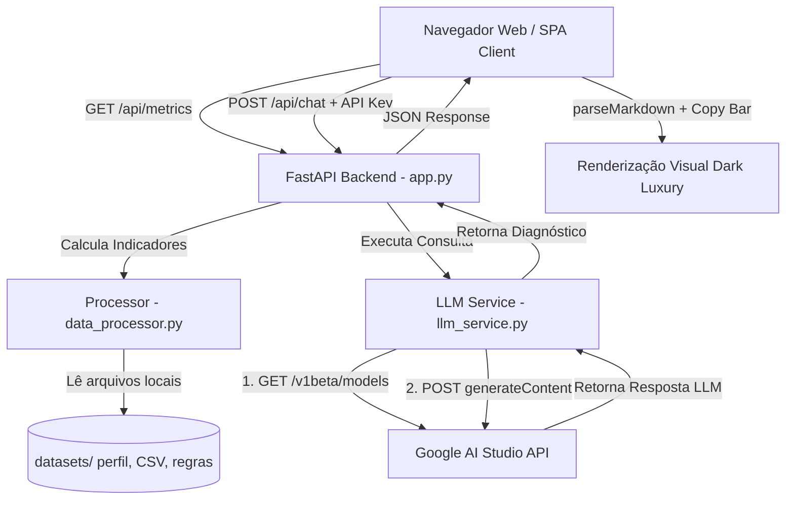

# 🏗️ Documento 04: Arquitetura da Aplicação

## 1. Visão Geral da Arquitetura

O **FinScan** adota uma arquitetura descentralizada e desacoplada, composta por um **Frontend SPA em Vanilla Web Standards** (HTML5, CSS3, ES6) e um **Backend RESTful FastAPI em Python**.

---

## 2. Componentes e Responsabilidades

### 🎨 Frontend (`src/frontend/`)
- `index.html`: Layout semântico em 2 painéis glassmorphic (*Indicadores* e *Chat*), cabeçalho de API Key com alternador de visibilidade e rodapé de autor.
- `style.css`: Design System *Dark Luxury Glassmorphic* com variáveis de cores (`Black Stallion`, `Elite Teal`, `Antique Brass`), suporte a cards de disclaimer e layout 100% fixo.
- `script.js`: Gerenciador de eventos, persistência opcional de API Key via `localStorage`, interpretador nativo de Markdown (`parseMarkdown`), barra externa de cópia e sincronização *live* do Dashboard.

### 🐍 Backend (`src/backend/`)
- `app.py`: Servidor ASGI FastAPI, rotas `/api/metrics` e `/api/chat`, tratamento de exceções e servidor de arquivos estáticos da SPA.
- `data_processor.py`: Motor de ingestão e agregação (Pandas), cálculo dos percentuais 50-30-20, cobertura de reserva e geração da mensagem inicial de boas-vindas.
- `llm_service.py`: Módulo de comunicação HTTP REST com a Gemini API, busca dinâmica de modelos suportados, controle de fallbacks e formatação PT-BR.